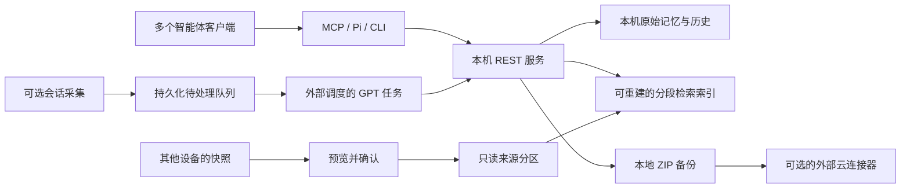

# Shared Mem0

**面向个人开发者的本地共享记忆：让多个 AI 智能体和多台电脑能够接着同一个项目工作。**

Local shared memory for a personal developer working across agents and devices. This project adds project/task scoping, lifecycle-aware retrieval, explicit device handoffs, and recoverable snapshots around the official Mem0 library.

当前发布版本：**2026.10.21.2**。代码以 [MIT](LICENSE) 许可公开；依赖与模型各自遵守原有许可，见 [THIRD_PARTY_NOTICES.md](THIRD_PARTY_NOTICES.md)。

## 它解决什么问题

换一个智能体、重新开一个会话，或者换一台电脑时，往往要重新解释项目背景。Shared Mem0 把已确认的需求、决定和阶段进展保存到本地，以稳定的项目 ID 供不同客户端读取，并保留来源和历史。

- **项目接续**：项目决定与任务进展一起检索；全局偏好单独处理，需要时读取完整原文。
- **长记录检索**：按实际模型的 token 上限分段，结合语义与关键词检索，让长记录后半段也参与匹配。
- **决定更新**：明确记录哪条新决定替代哪条旧决定，默认查询当前有效记录，仍可追溯历史。
- **多智能体共用**：提供 MCP 适配器和 Pi 扩展，包含 Codex、WorkBuddy、Claude Code、Pi 的配置辅助工具。
- **多设备接续**：另一台电脑的快照先预览、再确认采用，存入只读来源分区，保留来源设备并阻止旧快照覆盖新快照。
- **备份与恢复**：本地普通 ZIP 默认每 24 小时生成一次，保留 48 份；云端流程支持当前版、上一版和每日历史，并在独立下载校验后确认上传。

会话采集和云端同步**默认关闭**，需使用者自行配置。仓库不包含任何私人记忆、原始会话、客户端账号配置、密钥、实际云端文件 ID 或模型权重。

## 工作方式



一个 REST 进程持有本机存储；各客户端通过适配器请求它。不要让两台电脑同时打开同一个 Qdrant 数据目录，也不要直接用网盘同步正在运行的数据库。

详细设计见 [architecture.md](docs/architecture.md)。

## 快速开始（Windows / PowerShell）

推荐 **Windows、Python 3.13 64 位**，与原运行环境保持一致。代码要求至少 Python 3.11，但锁定依赖尚未逐个 Python 版本验证；其他操作系统也尚未完整验证。首次安装需要网络下载依赖和本地向量模型。模型缓存就绪后，默认检索与 `infer=false` 保存不需要调用模型 API。

```powershell
git clone https://github.com/Aaron-shi-bot/shared-mem0.git
cd shared-mem0
py -3.13 -m venv venv
.\venv\Scripts\python.exe -m pip install -r requirements.lock.txt
.\venv\Scripts\python.exe scripts/setup.py --device-id laptop-a
```

`setup.py` 只生成本机配置、随机本地 API token 和数据目录，不联网、不下载模型。默认数据目录为 `%LOCALAPPDATA%/SharedMem0`，已经位于仓库之外。若要使用自选目录或端口，请在**第一次初始化时**用下面的命令替换上面的 `setup.py` 命令：

```powershell
.\venv\Scripts\python.exe scripts/setup.py --data-root "$env:LOCALAPPDATA\SharedMem0" --port 8766 --device-id laptop-a
```

重复初始化会保留已有配置和密钥；若参数与已有安装冲突，程序会拒绝覆盖。迁移已有安装前请先备份并明确调整配置。

然后显式下载一次本地向量模型，再启动服务。模型缓存默认放在数据目录下的 `cache`；服务启动时强制离线使用该缓存，因此不能省略首次下载：

```powershell
.\venv\Scripts\python.exe scripts/download-model.py
.\venv\Scripts\python.exe app/server.py
```

在浏览器打开 **http://127.0.0.1:8766**。第一次加载模型或重建检索索引需要一些时间；通过界面状态确认引擎和索引已经就绪。

需要后台运行时，可使用 Windows 辅助脚本：

```powershell
powershell -NoProfile -ExecutionPolicy Bypass -File scripts/start.ps1
powershell -NoProfile -ExecutionPolicy Bypass -File scripts/stop.ps1
```

`start.ps1` 启动隐藏的看护进程；`stop.ps1` 停止并暂停自动重启。不要同时再启动一个前台服务去占用同一端口和数据目录。仓库不会自动安装系统开机任务。

## 接入智能体

初始化后先预览配置变更：

```powershell
.\venv\Scripts\python.exe scripts/configure_clients_v2.py
```

确认输出的客户端文件、托管指令和本地路径后再应用：

```powershell
.\venv\Scripts\python.exe scripts/configure_clients_v2.py --apply
```

脚本会为修改前存在的配置生成本地备份；这些账号配置不会放入可移植记忆备份。请根据实际安装的客户端核对预览，修改后重新加载对应客户端。具体配置位置与备份位置以脚本输出为准。

不使用辅助脚本时，MCP 的 stdio 命令是本机虚拟环境中的 Python，参数为 `-X utf8 app/mcp_bridge.py <client-name>`；配置文件中要使用这些文件在你电脑上的绝对路径。Pi 使用 `app/pi-memory.ts` 扩展。

建议智能体遵循以下流程：

1. 使用 `memory_projects` 找到并复用已有项目 ID。
2. 使用 `memory_handoff(project, query)` 同时读取项目决定和任务交接；片段不足时使用 `memory_get(id)` 获取完整记录。
3. 保存已确认事实与阶段进展时填写 `scope`、`project`、`task_id` 和 `source`，已提炼的文本使用 `infer=false`。
4. 决定变化时，先保存保留仍有效约束的完整新记录，再调用 `memory_supersede(old_id, new_id, reason)`。时间较新本身不构成替代依据。

CLI 接续入口可在客户端新工具尚未加载时使用：

```powershell
.\venv\Scripts\python.exe scripts/memory-handoff.py project demo-project --query "当前决定和下一步是什么"
```

## 可选：会话采集与 GPT 整理

采集器可以发现 Codex、WorkBuddy、Pi 和 Claude Code 已落盘的会话，按变化生成持久化队列。它会做基础脱敏，并在读取和提交时校验源文件是否变化；**它自身不调用 GPT，也不会用规则摘要代替 GPT**。

启用前请核对本机数据目录下 `automation/config.json`、项目映射及会话来源。启用后，需要另外安排一个可访问本机 CLI 的 GPT 任务领取片段、提炼带证据的记忆并提交。示例见 [gpt-task-prompt.md](examples/gpt-task-prompt.md)。任务和模型由使用者配置、承担相应运行费用。

GPT 任务不可用时，片段保留待处理。`last_scan` 较新表示扫描运行过；`pending=0` 也不能单独证明会话都已整理或上传。应同时检查 `needs_processing`、`retry_pending`、错误、`last_gpt_completed_at` 与云端 `local_changes_pending`。

基础脱敏不能保证清除所有敏感信息。启用会话采集意味着外部 GPT 任务可能读取处理后的会话片段；请先阅读 [SECURITY.md](SECURITY.md)。

## 可选：另一台电脑的记忆

每台电脑使用不同的 `device_id`，同一个项目复用相同项目 ID。把选定设备的备份 ZIP 下载到本机后，先预览：

```powershell
.\venv\Scripts\python.exe scripts/memory-handoff.py preview --device laptop-b --file .\downloads\snapshot.zip
```

预览会给出快照散列、先前版本散列以及新增、变化、删除、未变的数量。确认后，使用预览返回的实际值：

```powershell
.\venv\Scripts\python.exe scripts/memory-handoff.py apply --device laptop-b --file .\downloads\snapshot.zip --sha256 <preview-sha256> --previous-sha256 <previous-sha256>
```

首次导入没有先前版本时，省略 `--previous-sha256`。需要把来源设备的项目 ID 映射到本机稳定 ID 时，使用管理界面或 MCP 的 `project_map` 参数并在预览中核对。

导入的记忆保留来源，放在只读分区中参与检索；不会作为本机原创再次上传。更新也需要再次预览和确认。这套流程尚未实现无人值守的双向实时合并。

## 本地与云端备份

立即生成本地备份：

```powershell
.\venv\Scripts\python.exe scripts/backup.py
```

先预览恢复内容，再明确选择应用：

```powershell
.\venv\Scripts\python.exe scripts/restore.py --backup .\downloads\snapshot.zip
.\venv\Scripts\python.exe scripts/restore.py --backup .\downloads\snapshot.zip --apply
```

**新备份是无密码的普通 ZIP，包含私人记忆与所选原生记忆资产。** 不要将它提交到 GitHub 或放入公开网盘。旧加密备份仅在提供原有密钥时兼容读取。

云端模块只生成待上传快照及核验状态，实际上传由使用者授权的外部云连接器执行。公开版不会创建云账号、申请令牌或自动安排 GPT 定时任务。Google Drive 接续流程需要自行配置私有目标目录，并由外部任务完成上传、独立下载、SHA-256 校验和提交收据。只看到上传 API 返回成功不能算备份已验证。云端停用不会影响本地保存与备份。

## 验证范围与限制

升级前后的真实项目小样本中，16 个问题的第一条命中数从 `9/16` 提高到 `14/16`；补齐明确的新旧决定关系后为 `15/16`。这是一组已知、非盲测的回归样本，私人语料不随仓库公开，不能当作普遍准确率。

已有单机回归和其他设备真实快照的本机隔离验收；**两台实体电脑上的长期连续使用尚未验证**。客户端会话格式、依赖版本和云连接器接口都可能变化，升级后需要按自己的环境复验。公开回归不使用私人语料，也无需下载模型：

```powershell
.\venv\Scripts\python.exe -B -m unittest discover -s scripts -p "test_*.py" -q
```

验证口径与限制见 [validation.md](docs/validation.md)。

Shared Mem0 主要服务个人可信电脑环境。检索得到的记忆是带来源的参考资料；自动观察、历史导入和助手报告可能错误，不能提升为系统指令或用户已确认事实。这个项目没有提供面向不可信用户的多租户权限隔离。

## 目录

| 路径 | 用途 |
| --- | --- |
| `app/` | REST 服务、MCP/Pi 适配、检索、备份、会话队列与管理页面 |
| `scripts/` | 初始化、启动停止、接续、恢复、客户端配置与回归测试 |
| `docs/` | 设计与验证说明 |
| `examples/` | 不包含私人数据的外部任务示例 |
| `requirements.lock.txt` | 已锁定的 Python 依赖版本 |

本机生成的配置、数据、备份、模型缓存、客户端账号文件和临时领取结果不应提交到仓库。
