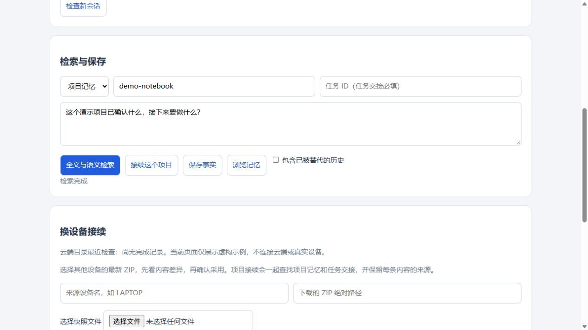
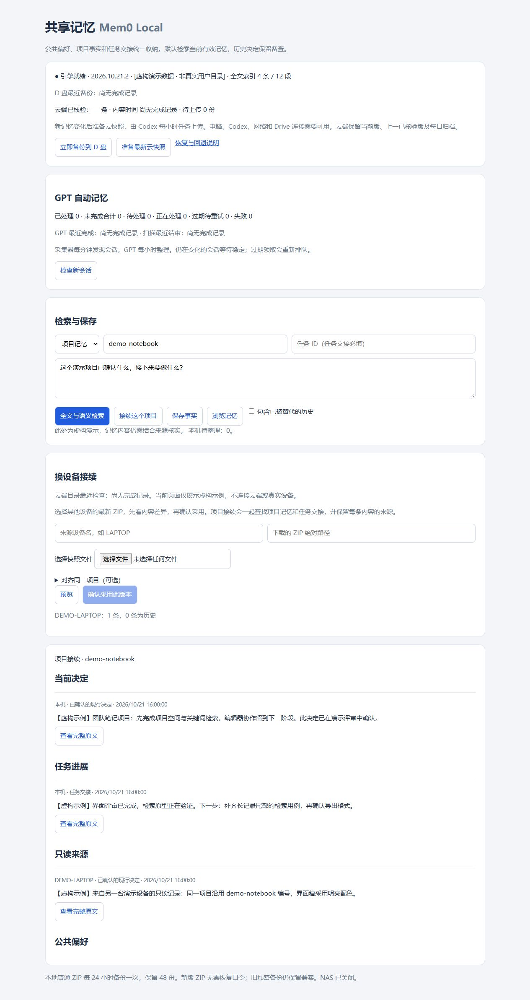

# Shared Mem0 · 多智能体共享项目记忆

**换一个 AI 助手、重新开一个会话，也能从同一份项目决定和交接继续工作。**

Shared Mem0 面向同时使用多个 AI 智能体的个人开发者。它把已确认的需求、决定和阶段进展保存在本机，按项目与任务组织，供 Codex、WorkBuddy、Claude Code 和 Pi 等客户端读取。换设备时，可以先预览另一台电脑的记忆，再明确选择采用。

项目基于官方 **mem0ai** 库构建，提供本地管理页面、REST 服务、MCP 适配器与 Pi 扩展。它是独立的本地集成项目，不是上述客户端或 Mem0 官方提供的产品。

[界面展示](#界面展示) · [主要功能](#主要功能) · [怎样使用](#怎样使用) · [运行入口](#运行入口) · [文档与许可](#文档与许可)

## 界面展示

在管理页面选择记忆范围、项目和问题，检索已保存的内容，也可以接续项目或预览其他设备的快照。



> 截图取自当前公开源码的原始 HTML 页面，使用专门构造的虚构 API 演示数据；未连接真实个人记忆服务。图片仅展示界面，不代表完整后端运行验收。

<details>
<summary>项目接续完整页面</summary>

完整页面下方列出当前决定、任务进展和只读设备来源；片段不够时，可以查看完整原文。下面是包含滚动区域的整页截图，内容均为虚构。



</details>

## 适合谁

- **在多个 AI 客户端之间切换的开发者**：希望助手先读同一份项目背景，减少重复解释，也减少沿用旧决定的情况。
- **长期推进多个项目的人**：需要把通用偏好、项目事实和本次任务进展分开，后续能找到来源和完整记录。
- **在不同电脑上继续工作的人**：希望先确认另一台设备带来了哪些变化，再采用其记忆。

## 主要功能

| 功能 | 实际用途 |
| --- | --- |
| 项目与任务分开管理 | 用稳定的项目 ID 组织记忆，任务交接另带任务 ID；全局偏好单独保存。 |
| 项目接续 | 同时读取项目决定、任务进展及来源，摘录不足时查看完整原文。 |
| 长记录检索 | 对完整记录分段，结合语义与关键词匹配，让长记录后半段也有机会被找到。 |
| 新旧决定管理 | 明确标记哪条新决定替代了旧决定；默认查当前有效内容，需要时回看历史。 |
| 多智能体接入 | 通过 MCP、Pi 扩展或 CLI 共用同一套本机记忆，提供客户端配置辅助脚本。 |
| 换设备接续 | 导入前预览变化和项目对应关系；确认后保留来源，以只读记录参与检索。 |
| 备份与恢复 | 为本机记忆提供可移植快照和恢复入口；会话采集、GPT 整理和云端流程按需启用。 |

## 怎样使用

**先给项目一个稳定编号，再让不同助手复用它。** 例如，同一个笔记应用始终使用 `demo-notebook`，不因换了客户端或工作目录就另建一个项目。

日常可以这样推进：

1. **开始工作时先接续。** 在页面里选择项目、填写问题，点击“接续这个项目”；智能体通过 `memory_projects` 找到已有项目，再用 `memory_handoff` 读取决定和任务进展。
2. **保存已确认的内容。** 把可复用的需求、决定和阶段进展写清楚，保留项目、任务与来源。已提炼好的文本使用 `infer=false` 保存。
3. **决定改变时留下关系。** 先保存完整的新决定，再通过页面或 `memory_supersede` 标记替代关系。时间较新本身不代表旧决定已经失效。
4. **换电脑前后核对变化。** 为设备设置不同编号，同一项目沿用同一项目 ID；选择快照，预览差异后确认采用。

客户端工具尚未加载时，可以使用仓库中的 [CLI 接续入口](scripts/memory-handoff.py)。接入方式与完整设计见 [架构说明](docs/architecture.md)。

## 运行入口

推荐 **Windows、Python 3.13 64 位**。首次运行需要安装 [锁定依赖](requirements.lock.txt)，使用 [初始化脚本](scripts/setup.py) 建立本机配置，再通过 [模型下载脚本](scripts/download-model.py) 准备本地向量模型。其他操作系统和 Python 版本的完整安装流程尚未验证。

准备完成后，用同一 Python 环境在仓库根目录启动：

```text
python app/server.py
```

浏览器打开 [http://127.0.0.1:8766](http://127.0.0.1:8766/)。智能体接入由 [客户端配置脚本](scripts/configure_clients_v2.py) 辅助完成，先预览变更，再按自己的客户端安装情况应用。详细设计和使用边界保留在下方文档中。

## 使用边界

- **记忆仍然需要核实。** 自动观察、历史导入和助手报告可能有误；检索结果是带来源的参考资料，不能自动成为用户已确认的决定。
- **可选功能需要另外启用。** 会话采集和云端流程默认关闭。会话整理需要另行配置外部 GPT 任务，程序本身不会用规则摘要冒充 GPT 处理；启用前应了解会话片段的数据流向。
- **面向个人可信电脑。** 这是本机共享记忆服务，未提供面向不可信用户的多租户隔离，不应直接开放为公共互联网服务。
- **多设备采用是显式操作。** 尚未提供无人值守的双向实时合并；两台实体电脑上的长期连续使用也尚未完整验证。

当前公开代码版本为 **2026.10.21.2**。已有验证的覆盖范围、合成回归入口和未测项见 [验证说明](docs/validation.md)；本页截图只用于展示界面。

## 文档与许可

| 入口 | 内容 |
| --- | --- |
| [架构说明](docs/architecture.md) | 记忆范围、检索、决定替代、设备接续及可选流程 |
| [验证说明](docs/validation.md) | 已有回归、验证条件和限制 |
| [安全说明](SECURITY.md) | 本机可信边界、敏感内容与漏洞报告 |
| [外部 GPT 任务示例](examples/gpt-task-prompt.md) | 不包含私人数据的整理任务参考 |
| [第三方归属](THIRD_PARTY_NOTICES.md) | mem0ai、检索依赖、模型及兼容客户端的许可与来源 |

本仓库原始集成代码采用 **[MIT License](LICENSE)**，Copyright © 2026 Aaron-shi-bot。第三方依赖与模型遵守各自许可；本仓库的 MIT 许可不替代它们的许可，也不表示获得所提及产品或供应商的背书。仓库不提供私人记忆、原始会话、真实凭据或模型权重。
